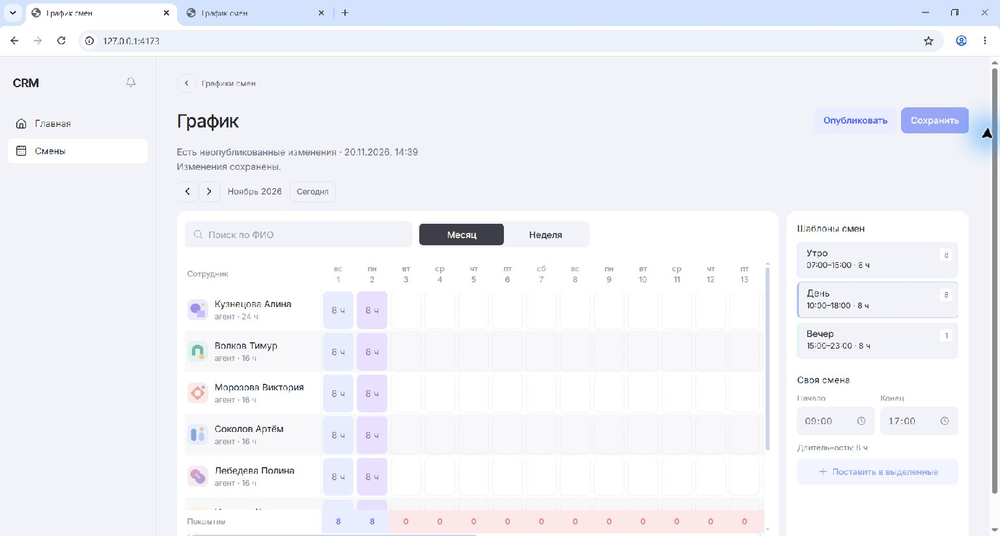

# График смен

Редактор расписания сотрудников на Vue 3 и Node.js. Поддерживает неделю и месяц, массовое назначение смен, свои часы через полночь, перенос, сохранение и публикацию. Production-сервер раздаёт приложение и API с одного домена.



Репозиторий: [spode-sleep/time-card-test-task](https://github.com/spode-sleep/time-card-test-task). Проект подготовлен к развёртыванию на alwaysdata, публикация сайта ещё не завершена. Порядок запуска — в [DEPLOYMENT.md](./DEPLOYMENT.md).

## Возможности

- Поиск по ФИО, календарная навигация, переключение недели и месяца без потери черновика.
- Одиночное, прямоугольное, добавочное и клавиатурное выделение; быстрое назначение всем найденным сотрудникам по дате.
- Шаблоны «Утро», «День», «Вечер», произвольные часы и редактирование существующей смены.
- Перенос мышью и клавиатурой, подтверждение замены занятой ячейки, живые суммы часов и покрытие.
- Атомарное сохранение, повтор потерянного ответа без дублирования, сравнение конфликтующих версий двух вкладок.
- Публикация независимого снимка расписания и статус последующих изменений.
- Виртуальные строки, отдельное демо на 1000 сотрудников и метрики производительности по `?metrics=1`.
- Адаптивный интерфейс от 320 px, локальные шрифты и собственные абстрактные SVG-аватары.

Подробные жесты, клавиши и сценарии редактора описаны в [руководстве](./USAGE.md).

## Стек и устройство

| Часть | Технологии |
| --- | --- |
| Клиент | Vue 3, TypeScript, Vite, Pinia, Axios, date-fns |
| Виртуализация | `@tanstack/vue-virtual` и `@tanstack/virtual-core` |
| Сервер | Node.js 24, Express 5, Zod, Prisma 7 с адаптером `pg` |
| Хранение | PostgreSQL 17, SQL-миграции, идемпотентный seed |
| Проверки | Vitest, jsdom, Supertest и отдельные временные БД |

`frontend/` содержит UI и черновик в Pinia, `backend/` — HTTP API и транзакции, `shared/` — общий контракт и правила времени. Сервер хранит снимки назначений, ревизии и квитанции успешных запросов. Сохранение проверяет базовую ревизию и фиксирует весь пакет одной транзакцией. Повтор того же `requestId` возвращает прежний результат. [Контракт API и схема данных](./API_CONTRACT.md).

## Быстрый запуск

Нужны Node.js из `.nvmrc` (24.22.3), npm 11 и Docker с Compose. На Windows команды выполняются в PowerShell из корня проекта.

```powershell
Copy-Item .env.example .env
npm ci
docker compose up -d database
npm run db:migrate
npm run db:seed
npm run dev
```

Открыть [приложение](http://localhost:5173/). Vite перенаправляет `/api` в Express на порт 3000. Seed добавляет восемь сотрудников, три шаблона и пустое расписание. Повторный seed сохраняет правки и назначения; прежние локальные PNG-аватары обновляет до SVG.

Для запуска всей среды в контейнерах:

```sh
docker compose build
docker compose run --rm backend npm run db:migrate
docker compose run --rm backend npm run db:seed
docker compose up -d
```

Остановка — `docker compose stop`. Том PostgreSQL сохраняется.

## Production

```sh
npm run build
npm run db:migrate
npm run db:seed:production
```

Для запуска установить `NODE_ENV=production`, `DATABASE_URL`, `HOST` и `PORT` в окружении или в локальном `.env`. Затем:

```sh
npm start
```

Express раздаёт `frontend/dist`, включая аватары и шрифты. HTML и API не кэшируются, файлы с хешами в `/assets` кэшируются надолго. Неизвестный `/api/*` возвращает JSON 404. Пути к клиенту вычисляются относительно модуля, запуск из другого рабочего каталога поддерживается.

Для Docker используется отдельный [production Compose](./compose.production.yaml) с миграциями перед стартом, непривилегированным процессом Node.js и постоянным томом БД. Подготовлен архив `npm run package:production` для alwaysdata и других Node.js-хостингов. Настройка переменных, HTTPS, миграций, резервных копий и загрузки архива — в [инструкции развёртывания](./DEPLOYMENT.md).

## Переменные окружения

| Переменная | Назначение |
| --- | --- |
| `DATABASE_URL` | Обязательная строка подключения к PostgreSQL |
| `NODE_ENV` | `production` включает раздачу собранного клиента |
| `HOST` / `IP` | Адрес прослушивания; `HOST` имеет приоритет, `IP` поддерживает alwaysdata |
| `PORT` | Порт Express, по умолчанию 3000 |
| `FRONTEND_PORT` | Порт Vite для разработки, по умолчанию 5173 |
| `BACKEND_URL` | Адрес прокси API при разработке |
| `POSTGRES_USER`, `POSTGRES_PASSWORD`, `POSTGRES_DB`, `POSTGRES_PORT` | Локальная БД в development Compose |

Шаблоны: [.env.example](./.env.example), [.env.production.example](./.env.production.example). Настоящие `.env` и архивы выпуска исключены из Git.

## Проверки

```sh
npm run check
npm run test:frontend
npm run test:integration
npm run test:persistence
npm run test:production
```

Для последних трёх команд нужен работающий PostgreSQL и пользователь с правами `CREATE DATABASE`. Каждый сценарий создаёт и удаляет свою БД; основное расписание не используется для проверочных записей.

120 тестов клиента проверяют календарные границы, выделение, назначение, часы, перенос, виртуальные строки, сохранение и конфликты. 36 тестов API проверяют валидацию, атомарность, уникальность ячейки, повторы, ревизии и публикации. Сквозной production-сценарий проверяет чистую миграцию, собранный seed, HTML/JS/SVG/API с одного порта, HTTP-кэш, 404 и сохранность смены с публикацией после перезапуска процесса.

Ручной проход в Chrome включает viewport 1500×906 и 320×650, настоящие жесты, потерянный ответ и две вкладки. [Результаты и снимки этапа 11](./IMPLEMENTATION_PLAN.md#11-проверить-ключевые-сценарии).

`npm run preview:qa` поднимает собранный клиент с настоящим API в отдельной БД на [порту 4173](http://127.0.0.1:4173/). Команды в терминале: `offline`, `online`, `reject-next`, `lose-next`, `quit`. Выход удаляет временную БД. `npm run check:deployment -- https://ИМЯ.alwaysdata.net` выполняет чтение опубликованного сайта и API без изменения расписания.

## Производительность

```sh
npm run preview:large
```

Открыть [демо с метриками](http://127.0.0.1:4180/?metrics=1). Демо использует 1000 вымышленных сотрудников; сохранять их в БД нельзя. В месяце на 30 дней в DOM проверены 9–14 строк и 270–420 ячеек вместо 30 000. Выделение и черновик сохраняют данные невидимых строк.

Панель `?metrics=1` загружается отдельно и показывает LCP, INP, CLS, FPS, кадр p95, длинные задачи и размер DOM. Данные остаются в браузере, доступен экспорт JSON. [Проверочный экспорт](./performance-step-9.json): LCP 168 мс, INP 120 мс, CLS 0,000206 при viewport 1280×720; это результаты одного локального визита, а не гарантия для любого устройства.

## Принятые решения

- Одно общее расписание; авторизация и роли не входят в задание. Публичная демонстрация должна содержать только демонстрационные данные.
- Даты — календарные `YYYY-MM-DD`, часы — местное время расписания `Europe/Moscow`. Начало позже конца означает окончание на следующий день; равные часы не обозначают сутки.
- Все три шаблона длятся 8 часов; подпись «9 ч» у вечернего шаблона в снимке исправлена по фактическому интервалу 15:00–23:00.
- Изменения остаются в памяти вкладки до сохранения. Принудительное закрытие с проигнорированным предупреждением может потерять черновик.
- Публикация атомарно сохраняет черновик и создаёт неизменяемый полный снимок; обновления рабочего расписания не меняют прежние публикации.
- Вёрстка сверена с сохранёнными PNG Figma; исходные CSS-размеры недоступны без OAuth. Абстрактные аватары нарисованы отдельно по пожеланию пользователя.

## Материалы

- [Задание и макеты в Figma](https://www.figma.com/design/QVdDSEGTL1bWg7UmuPpoPe/?node-id=0-1).
- [План и sanity check этапов](./IMPLEMENTATION_PLAN.md).
- [API и данные](./API_CONTRACT.md).
- [Руководство по редактору](./USAGE.md).
- [Развёртывание и сдача](./DEPLOYMENT.md).
